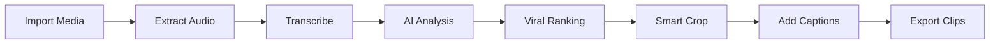
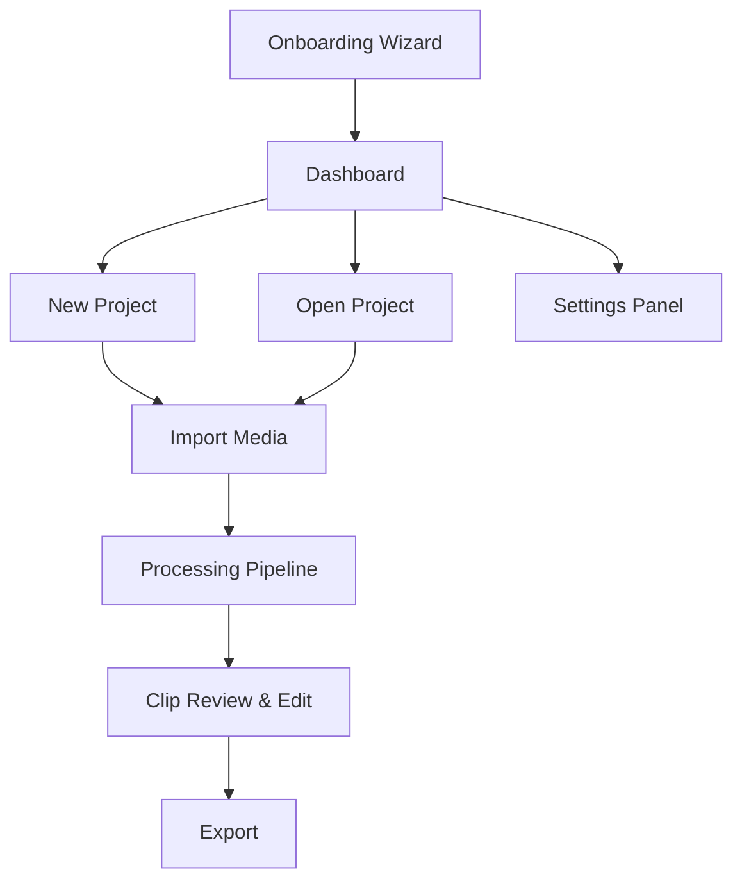

# Product Requirements Document (PRD)
## ClipForge — AI-Powered Short-Form Video Clip Studio

**Version**: 1.0  
**Date**: October 2026  
**Author**: Product & Engineering  
**Status**: Draft  

---

## 1. Executive Summary

**ClipForge** is a **local-first, privacy-focused desktop application** that transforms long-form video/audio content (podcasts, streams, webinars, interviews) into high-impact, vertical short-form clips (9:16 portrait) optimized for TikTok, YouTube Shorts, and Instagram Reels.

The application uses **AI-powered viral moment detection**, **automated transcription**, **smart speaker-tracking vertical reframing**, and **dynamic caption generation** to produce publish-ready clips with minimal manual effort.

### Why Build This?

| Problem | Solution |
|:---|:---|
| SaaS tools charge $20–50/mo with credit limits | ClipForge is free, self-hosted, unlimited |
| SaaS uploads your raw footage to cloud servers | ClipForge processes everything locally |
| Existing open-source tools have poor UX | ClipForge has a premium, modern desktop UI |
| No single tool does detection + reframing + captions + copy | ClipForge is an end-to-end pipeline |

---

## 2. Competitive Analysis

### 2.1 Commercial SaaS Competitors

| Feature | OpusClip | Quso.ai (Vidyo.ai) | SubMagic | Kapwing |
|:---|:---|:---|:---|:---|
| **Pricing** | $19–149/mo | $22–107/mo | $27–79/mo | $24–79/mo |
| **Viral Scoring** | ✅ Proprietary "ClipAnything" | ✅ IntelliClips | ❌ | ❌ |
| **Face Tracking Crop** | ✅ | ✅ | ❌ | ✅ |
| **Auto Captions** | ✅ 97%+ accuracy | ✅ | ✅ (core feature) | ✅ |
| **Social Copy Generation** | ✅ | ✅ AI Writer + Planner | ❌ | ❌ |
| **Local Processing** | ❌ Cloud only | ❌ Cloud only | ❌ Cloud only | ❌ Cloud only |
| **Watermark (free tier)** | ✅ Yes | ✅ Yes | ✅ Yes | ✅ Yes |
| **YouTube Import** | ✅ | ✅ | ✅ | ✅ |

#### Key UI/UX Observations:
- **OpusClip**: Clean, professional, speed-optimized. Dashboard → Upload → Clips list with viral scores. "One-click" workflow philosophy.
- **Quso.ai**: Dashboard-oriented, template-heavy. Full social suite (planner, scheduler, AI writer). More complex but comprehensive.
- **SubMagic**: Focuses on caption styling. Beautiful template gallery for subtitle designs.

### 2.2 Open-Source Competitors

| Feature | AutoShorts (Original) | OpenShorts | Clippyme | Clipmint | AI-Youtube-Shorts-Gen |
|:---|:---|:---|:---|:---|:---|
| **Face Tracking** | ❌ Center-crop only | ✅ MediaPipe + YOLOv8 | ✅ Gemini-based | ❌ | ❌ |
| **Viral Scoring** | ✅ Multi-LLM | ✅ Gemini | ✅ Gemini | ✅ LLM-based | ✅ LLM-based |
| **Caption Styles** | ✅ Basic burned-in | ✅ Word-level sync | ✅ | ✅ | ❌ |
| **Desktop App** | ✅ Tauri | ❌ Docker/Web | ❌ Web | ❌ CLI | ❌ CLI/Web |
| **Offline Mode** | ✅ Ollama + Whisper | ❌ | ❌ | ✅ Whisper | ✅ Whisper |
| **YouTube Import** | ✅ yt-dlp | ❌ | ❌ | ✅ | ✅ |
| **UI Quality** | ⭐⭐⭐⭐ | ⭐⭐⭐ | ⭐⭐ | ⭐ | ⭐ |

### 2.3 ClipForge Differentiation

ClipForge aims to combine the **best of all worlds**:

```
✅ Desktop-native app (not Docker/web/CLI)
✅ AI face-tracking vertical reframe (not just center-crop)
✅ Multiple caption style templates (like SubMagic)
✅ Multi-LLM support (DeepSeek, Claude, Gemini, OpenAI, Ollama, Groq)
✅ Full offline mode (Whisper + Ollama)
✅ YouTube import with copyright check
✅ Social media copy generation
✅ Batch processing (queue multiple videos)
✅ Premium, modern UI (dark mode, animations, glassmorphism)
✅ No watermarks, no limits, no subscriptions
```

---

## 3. Target Users

| Persona | Description | Key Need |
|:---|:---|:---|
| **YouTube Creator** | Makes long-form content, wants shorts for growth | Fast clip extraction with viral optimization |
| **Podcast Host** | Audio-first, wants visual clips for promotion | Audio-to-video + captions + speaker detection |
| **Social Media Manager** | Handles multiple clients' content | Batch processing, copy generation, consistent quality |
| **Indie Developer / Power User** | Wants full control, self-hosted, private | Open source, configurable, API-key-based |

---

## 4. Tech Stack Decision

### 4.1 Current Stack (AutoShorts): Tauri + Rust + React

| Aspect | Assessment |
|:---|:---|
| Performance | ⭐⭐⭐⭐⭐ — Rust backend is blazingly fast |
| Bundle Size | ⭐⭐⭐⭐⭐ — ~10MB installer |
| Developer Accessibility | ⭐⭐ — Rust has steep learning curve |
| AI/ML Ecosystem | ⭐⭐ — Limited compared to Python |
| FFmpeg Integration | ⭐⭐⭐ — Process spawning via std::process |
| Packaging | ⭐⭐⭐⭐ — Tauri builds native installers |

### 4.2 Proposed Stack: Python + Flask + pywebview + React (Vite)

| Aspect | Assessment |
|:---|:---|
| Performance | ⭐⭐⭐ — Python is slower but adequate for this use case |
| Bundle Size | ⭐⭐⭐ — ~50-100MB with Python bundled |
| Developer Accessibility | ⭐⭐⭐⭐⭐ — Python is the most accessible language |
| AI/ML Ecosystem | ⭐⭐⭐⭐⭐ — Rich (Whisper, MediaPipe, YOLO, etc.) |
| FFmpeg Integration | ⭐⭐⭐⭐⭐ — ffmpeg-python library + subprocess |
| Packaging | ⭐⭐⭐ — PyInstaller / Nuitka |

### 4.3 Verdict: **Python Stack is Better for ClipForge**

> [!IMPORTANT]
> **The Python stack is the recommended choice** for ClipForge because:
> 1. **AI/ML is the core value** — Face tracking (MediaPipe), local whisper, YOLO speaker detection all run natively in Python
> 2. **Developer velocity** — Python is 3-5x faster to iterate on than Rust
> 3. **Single developer friendly** — No need to context-switch between Rust and TypeScript
> 4. **The heavy lifting is FFmpeg** — The actual video processing is done by FFmpeg, not the app language. Python just orchestrates it.
> 5. **Performance is not the bottleneck** — FFmpeg and AI model inference are the slow parts, not the Python backend wrapper

> [!NOTE]
> **The performance trade-off is acceptable** because:
> - Startup time: ~1-2s (Python) vs ~0.3s (Rust) — acceptable for a desktop app
> - Memory: ~80-150MB (Python) vs ~30-50MB (Rust) — acceptable on modern machines
> - The actual video processing (FFmpeg, AI inference) takes minutes regardless of backend language

---

## 5. Feature Specification

### 5.1 Core Pipeline



### 5.2 Feature Matrix (MVP → V2 → V3)

| Feature | MVP (v1.0) | V2.0 | V3.0 |
|:---|:---|:---|:---|
| **Import** | Local file import | + YouTube URL import | + Batch import, drag & drop folder |
| **Transcription** | Deepgram API, Local Whisper | + Groq Whisper, AssemblyAI | + Real-time preview during transcription |
| **AI Analysis** | DeepSeek, Claude, Ollama | + Gemini, OpenAI, OpenRouter, Groq | + Custom fine-tuned models |
| **Viral Scoring** | Score + Hook + Rationale | + Trend alignment, platform optimization | + Historical learning from user picks |
| **Reframing** | Center-crop (portrait) | + Face tracking (MediaPipe) | + Multi-speaker tracking, split screen |
| **Captions** | Burned-in word-by-word | + 5 style templates | + Custom font/color/animation editor |
| **Caption Animation** | Static highlight | + Karaoke-style word reveal | + Pop-in, bounce, glow effects |
| **Export** | MP4 H.264 | + Batch export, SRT download | + Direct publish to TikTok/YouTube |
| **Copy Generation** | Hook text per clip | + Platform-specific captions & hashtags | + A/B hook variants |
| **Project Management** | Create, rename, delete | + Project templates, tags | + Team sharing, cloud sync |
| **Onboarding** | API key wizard | + Ollama auto-install | + One-click setup script |
| **Settings** | API key management | + Theme customization | + Keyboard shortcuts |
| **YouTube Import** | yt-dlp download | + Copyright pre-check | + Playlist batch import |

### 5.3 Detailed Feature Specs

#### 5.3.1 Media Import
- **Supported formats**: MP4, MOV, MKV, AVI, WEBM, MP3, WAV, M4A, FLAC
- **Max file size**: Unlimited (local processing)
- **YouTube Import**: Paste URL → copyright pre-check → download via yt-dlp
- **Drag & drop**: Drag files directly into the app window
- **Media probe**: Display duration, resolution, codec info after import

#### 5.3.2 Transcription Engine
- **Cloud**: Deepgram Nova-2 (default — fast, accurate, speaker diarization)
- **Local**: OpenAI Whisper (offline, multiple model sizes: tiny → large)
- **Features**: Word-level timestamps, speaker diarization, language detection
- **Output**: Normalized transcript with words + segments + speakers

#### 5.3.3 AI Viral Moment Detection
- **Input**: Full transcript text
- **Output**: 3-10 ranked clip candidates with:
  - `start_sec`, `end_sec` — precise timestamps
  - `score` — 0-100 virality score
  - `hook` — compelling opening hook text
  - `rationale` — why this moment is viral-worthy
- **Supported LLM Providers**:
  - DeepSeek (recommended — best cost/quality ratio)
  - Claude (premium — best hooks/copywriting)
  - Gemini (good value)
  - OpenAI GPT-4
  - OpenRouter (access to any model)
  - Groq (fast inference)
  - Ollama (fully offline)
  - Custom OpenAI-compatible endpoints

#### 5.3.4 Smart Vertical Reframing (v2.0+)
- **Phase 1 (MVP)**: Center-crop from 16:9 → 9:16
- **Phase 2**: MediaPipe face detection → track active speaker
- **Phase 3**: Multi-speaker → split screen or dynamic pan

#### 5.3.5 Caption System
- **Word-by-word highlight**: Active word is emphasized
- **Caption chunk size**: 2-3 words per display chunk
- **Style templates** (v2.0):
  - Classic (white text, black outline)
  - Neon (glowing colored text)
  - Minimal (subtle grey, clean)
  - Bold (large, impactful)
  - Gradient (animated color shift)
- **Position**: Bottom-third of frame (adjustable)

#### 5.3.6 Export & Output
- **Format**: MP4 H.264, 1080x1920 (9:16), 30fps
- **Captions**: Burned-in via FFmpeg drawtext
- **SRT**: Downloadable subtitle file per clip
- **Batch export**: Queue all selected clips for rendering
- **Output directory**: Organized by project name

---

## 6. UI/UX Design Guidelines

> [!IMPORTANT]
> ClipForge must have its **own unique visual identity** — do NOT copy AutoShorts' UI.

### 6.1 Design Philosophy
- **Dark-first**: Deep charcoal/slate background (#0f1117, #1a1d23)
- **Accent color**: Electric violet/purple gradient (#7c3aed → #a855f7)
- **Typography**: Inter (UI), JetBrains Mono (code/timestamps)
- **Glassmorphism**: Frosted glass panels with subtle backdrop blur
- **Micro-animations**: Smooth transitions, hover effects, loading states
- **Dense but breathable**: Information-rich without feeling cluttered

### 6.2 Screen Flow



### 6.3 Key Screens

#### Screen 1: Onboarding Wizard
- Step-by-step setup: choose Cloud vs Offline
- API key inputs with test/validate buttons
- Ollama auto-detect and model pull
- Whisper installation helper
- Beautiful animated progress indicators

#### Screen 2: Dashboard (Project Manager)
- Grid/list view of all projects
- Each project card shows: thumbnail, name, duration, status, clip count, date
- Quick actions: rename, delete, open, re-analyze
- "New Project" prominent CTA button
- Search and sort/filter projects

#### Screen 3: Project Workspace
- **Left panel**: Media preview player with timeline scrubber
- **Center panel**: Transcript view (scrollable, word-highlighted)
- **Right panel**: Clip candidates list (ranked by score)
- **Bottom bar**: Pipeline status (Importing → Transcribing → Analyzing → Rendering)
- **Video preview**: In-app 9:16 portrait preview before export

#### Screen 4: Clip Review
- Side-by-side: Original (landscape) vs. Cropped (portrait) preview
- Caption preview with style selector
- Edit timestamps (drag handles on timeline)
- Hook text display and edit
- Export button per clip or batch

#### Screen 5: Settings Panel
- Slide-over panel (like AutoShorts)
- API key management with connection test
- LLM provider selector
- Transcription engine selector
- Caption style defaults
- Theme preferences
- Data directory configuration

### 6.4 Design Inspirations (NOT to copy, but for mood/quality)
- **Linear.app**: Clean, fast, keyboard-first
- **Raycast**: Dark, glassmorphism, premium feel
- **Vercel Dashboard**: Typography, spacing, information hierarchy
- **Figma**: Panel-based workspace layout

---

## 7. Technical Architecture

### 7.1 System Architecture

```
┌─────────────────────────────────────────────┐
│              pywebview Window                │
│  ┌─────────────────────────────────────────┐│
│  │          React + Vite Frontend           ││
│  │  (TypeScript, CSS, Lucide Icons)        ││
│  └────────────────┬────────────────────────┘│
│                   │ fetch() / JS API Bridge  │
│  ┌────────────────┴────────────────────────┐│
│  │         Flask Backend (Python)           ││
│  │  ┌──────┐ ┌──────┐ ┌───────┐ ┌───────┐ ││
│  │  │Routes│ │Media │ │Transc.│ │  LLM  │ ││
│  │  │ API  │ │Svc   │ │  Svc  │ │  Svc  │ ││
│  │  └──┬───┘ └──┬───┘ └───┬───┘ └───┬───┘ ││
│  │     │        │         │         │      ││
│  │  ┌──┴────────┴─────────┴─────────┴──┐   ││
│  │  │        SQLite Database           │   ││
│  │  └──────────────────────────────────┘   ││
│  └─────────────────────────────────────────┘│
│                                             │
│  External Dependencies:                     │
│  ├── FFmpeg / FFprobe (system PATH)         │
│  ├── yt-dlp (system PATH, optional)         │
│  ├── Ollama (localhost:11434, optional)      │
│  └── Whisper (pip package, optional)         │
└─────────────────────────────────────────────┘
```

### 7.2 Backend Module Structure

```
clipforge/
├── main.py                  # pywebview launcher + Flask app init
├── backend/
│   ├── __init__.py
│   ├── app.py               # Flask application factory
│   ├── config.py            # Environment & settings management
│   ├── routes/
│   │   ├── __init__.py
│   │   ├── projects.py      # Project CRUD endpoints
│   │   ├── media.py         # Media import, probe, extract
│   │   ├── transcription.py # Transcription endpoints
│   │   ├── analysis.py      # LLM analysis endpoints
│   │   ├── rendering.py     # Clip rendering endpoints
│   │   └── system.py        # Environment status, settings
│   ├── services/
│   │   ├── __init__.py
│   │   ├── media_service.py     # FFmpeg operations
│   │   ├── transcription_service.py  # Deepgram, Whisper
│   │   ├── llm_service.py      # Multi-provider LLM calls
│   │   ├── caption_service.py  # Caption generation & styling
│   │   └── youtube_service.py  # yt-dlp integration
│   ├── models/
│   │   ├── __init__.py
│   │   ├── project.py
│   │   ├── transcript.py
│   │   ├── candidate.py
│   │   └── clip.py
│   └── database.py          # SQLite connection & migrations
├── frontend/                # React + Vite (separate build)
│   ├── src/
│   │   ├── App.tsx
│   │   ├── components/
│   │   ├── pages/
│   │   ├── hooks/
│   │   ├── api/
│   │   └── styles/
│   ├── package.json
│   ├── vite.config.ts
│   └── tsconfig.json
├── requirements.txt
├── .env.example
└── README.md
```

### 7.3 Database Schema

```sql
CREATE TABLE projects (
    id TEXT PRIMARY KEY,
    name TEXT,
    source_path TEXT NOT NULL,
    source_duration REAL,
    status TEXT NOT NULL DEFAULT 'imported',
    transcription_mode TEXT NOT NULL DEFAULT 'cloud',
    caption_style TEXT DEFAULT 'classic',
    created_at TEXT NOT NULL,
    updated_at TEXT NOT NULL
);

CREATE TABLE transcripts (
    id TEXT PRIMARY KEY,
    project_id TEXT NOT NULL REFERENCES projects(id),
    engine TEXT NOT NULL,
    raw_json TEXT NOT NULL,
    language TEXT,
    created_at TEXT NOT NULL
);

CREATE TABLE candidates (
    id TEXT PRIMARY KEY,
    project_id TEXT NOT NULL REFERENCES projects(id),
    start_sec REAL NOT NULL,
    end_sec REAL NOT NULL,
    score REAL NOT NULL,
    hook TEXT NOT NULL,
    rationale TEXT NOT NULL,
    rank INTEGER NOT NULL,
    selected INTEGER NOT NULL DEFAULT 0
);

CREATE TABLE clips (
    id TEXT PRIMARY KEY,
    candidate_id TEXT NOT NULL REFERENCES candidates(id),
    status TEXT NOT NULL DEFAULT 'pending',
    output_path TEXT,
    face_track_json TEXT,
    caption_ass_path TEXT,
    render_log TEXT
);

CREATE TABLE clip_copies (
    id TEXT PRIMARY KEY,
    clip_id TEXT NOT NULL REFERENCES clips(id),
    platform TEXT NOT NULL,
    hook_text TEXT,
    caption_text TEXT,
    hashtags TEXT
);
```

### 7.4 API Endpoints

| Method | Endpoint | Description |
|:---|:---|:---|
| GET | `/api/status` | Environment status (FFmpeg, keys, providers) |
| POST | `/api/projects` | Create new project from file path |
| GET | `/api/projects` | List all projects |
| GET | `/api/projects/:id` | Get project detail + transcript + candidates |
| DELETE | `/api/projects/:id` | Delete project |
| PATCH | `/api/projects/:id` | Rename project |
| POST | `/api/projects/:id/probe` | Probe media file metadata |
| POST | `/api/projects/:id/extract-audio` | Extract WAV audio from video |
| POST | `/api/projects/:id/transcribe` | Start transcription |
| POST | `/api/projects/:id/analyze` | Generate viral clip candidates |
| POST | `/api/projects/:id/render/:candidateId` | Render a single clip |
| POST | `/api/projects/:id/render-batch` | Render all selected clips |
| POST | `/api/test-connection` | Test LLM provider connection |
| POST | `/api/youtube/check` | YouTube copyright check |
| POST | `/api/youtube/download` | Download YouTube video |
| POST | `/api/ollama/pull` | Pull Ollama model |
| GET | `/api/settings` | Get app settings |
| PUT | `/api/settings` | Update app settings |

---

## 8. Non-Functional Requirements

| Requirement | Target |
|:---|:---|
| **Startup Time** | < 3 seconds |
| **Memory Usage** | < 200MB idle, < 500MB during processing |
| **Supported OS** | Windows 10+, macOS 12+, Ubuntu 22.04+ |
| **Python Version** | 3.10+ |
| **Node.js** | 18+ (build-time only) |
| **FFmpeg** | 5.0+ |
| **Offline Mode** | Fully functional with Ollama + Whisper |
| **Data Privacy** | Zero cloud telemetry, all processing local |

---

## 9. Risk Assessment

| Risk | Impact | Mitigation |
|:---|:---|:---|
| Python startup is slow | Medium | Pre-warm Flask server, lazy imports |
| pywebview rendering inconsistency across OS | Medium | Test on all 3 platforms, use WebView2 on Windows |
| PyInstaller bundle size is large | Low | Use Nuitka for smaller bundles, or ship as pip install |
| FFmpeg not installed by user | High | Auto-detect, show clear install instructions in onboarding |
| LLM API rate limits | Low | Implement retry with backoff, cache results |

---

## 10. Success Metrics (v1.0)

| Metric | Target |
|:---|:---|
| End-to-end pipeline works | 10-min video → clips in < 5 minutes |
| Clip quality | 80%+ clips are usable without manual edit |
| Supported LLM providers | ≥ 4 providers working |
| UI responsiveness | No frozen UI during long operations |
| GitHub stars (6 months) | 500+ |

---

## 11. Timeline

| Phase | Duration | Deliverables |
|:---|:---|:---|
| **Phase 1: Foundation** | Week 1-2 | Python backend, SQLite, Flask API, pywebview shell |
| **Phase 2: Core Pipeline** | Week 3-4 | Import → Transcribe → Analyze → Render pipeline |
| **Phase 3: Frontend** | Week 5-6 | React UI with all screens, dark theme |
| **Phase 4: Polish** | Week 7-8 | Caption styles, onboarding wizard, error handling |
| **Phase 5: Packaging** | Week 9 | PyInstaller builds for Win/Mac/Linux |
| **Phase 6: Testing** | Week 10 | Cross-platform testing, bug fixes, README |

---

## 12. Open Questions

- [ ] Should we support real-time WebSocket progress updates (SSE vs polling)?
- [ ] Should captions be ASS subtitles or FFmpeg drawtext?
- [ ] Should we build face tracking into MVP or defer to v2?
- [ ] Should the frontend be embedded in the Python package or served separately?
- [ ] Export format: only MP4 or also MOV/WEBM?

---

*This PRD is a living document. Update as decisions are made and features evolve.*
