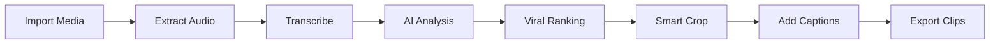

# ClipForge

**AI-Powered Short-Form Video Clip Studio** — local-first, privacy-focused.

ClipForge transforms long-form video/audio content (podcasts, streams, webinars, interviews) into high-impact vertical clips (9:16) optimized for TikTok, YouTube Shorts, and Instagram Reels — using AI viral moment detection, automated transcription, and dynamic burned-in captions.

## Why ClipForge?

| Problem (SaaS tools) | ClipForge |
|:---|:---|
| $20-50/mo subscriptions with credit limits | Free, unlimited, self-hosted |
| Your raw footage uploaded to cloud servers | Everything processed locally |
| Watermarks on free tiers | No watermarks, ever |
| Four separate tools needed | End-to-end pipeline in one app |

## Features

- **Local file import** — MP4, MOV, MKV, AVI, WEBM, MP3, WAV, M4A, FLAC
- **Transcription** — Deepgram Nova-2 (cloud) or OpenAI Whisper (local/offline), word-level timestamps + speaker diarization
- **AI viral moment detection** — DeepSeek, Claude, Gemini, OpenAI, OpenRouter, Groq, Ollama (offline), or any custom OpenAI-compatible endpoint
- **Smart vertical reframing** — 9:16 center-crop at 1080x1920
- **Word-by-word captions** — Classic, Neon, Minimal, Bold styles, burned in via FFmpeg
- **Batch export** — Select multiple candidates and render them all
- **YouTube import** — Copyright pre-check + yt-dlp download
- **Social copy per clip** — Hook text and rationale for every candidate

## Tech Stack

- **Backend**: Python 3.10+, Flask, SQLite, FFmpeg, pywebview
- **Frontend**: React 19, TypeScript, Vite, Lucide icons
- **Desktop shell**: pywebview (native WebView, no Electron)

## Quick Start

### Prerequisites

- Python 3.10+
- Node.js 18+ (frontend build only)
- FFmpeg 5.0+ on PATH (`sudo apt install ffmpeg` / `brew install ffmpeg`)
- Optional: [yt-dlp](https://github.com/yt-dlp/yt-dlp) for YouTube import

### 1. Backend setup

```bash
# Create virtual environment and install dependencies
python3 -m venv .venv
source .venv/bin/activate
pip install -r requirements.txt
```

### 2. Frontend build

```bash
cd frontend
npm install
npm run build
cd ..
```

### 3. Configure API keys (optional)

```bash
cp .env.example .env
# Edit .env — add at least one LLM provider key (e.g. DEEPSEEK_API_KEY)
```

### 4. Run

```bash
source .venv/bin/activate
python main.py
```

The ClipForge desktop window opens at `http://127.0.0.1:5174`.

### Development mode (hot reload)

```bash
# Terminal 1 — frontend with HMR
cd frontend && npm run dev

# Terminal 2 — backend
source .venv/bin/activate && python main.py --debug
```

## How It Works



1. **Create a project** from any media file on disk
2. **Transcribe** — Deepgram (cloud) or Whisper (local)
3. **Analyze** — the LLM ranks the top 3-8 viral moments with hooks and rationale
4. **Render** — center-crop to 9:16, burn in word-by-word captions, export MP4 H.264

## Testing

```bash
source .venv/bin/activate
pip install pytest pytest-cov
pytest tests/ -v --cov=backend
```

## Packaging (standalone executable)

```bash
pip install pyinstaller
pyinstaller --name ClipForge --onedir --windowed \
  --add-data "frontend/dist:frontend/dist" \
  main.py
```

## Privacy

All processing happens on your machine. Only transcripts are sent to the AI provider you configure (nothing at all in offline mode with Ollama + Whisper). No telemetry.

## License

MIT
